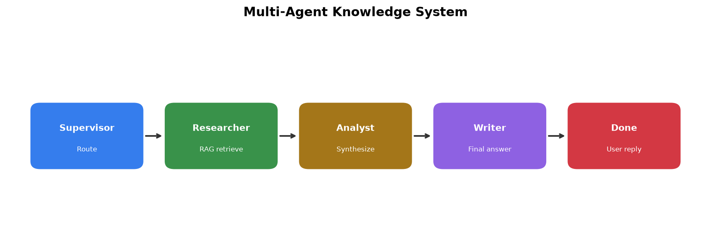
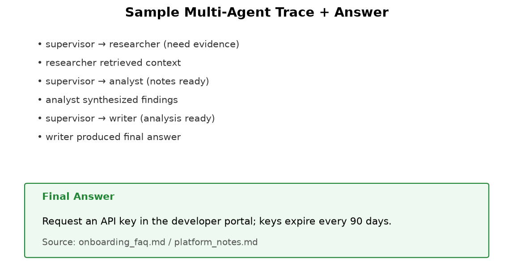

# Multi-Agent Knowledge System

A **LangGraph multi-agent** system with RAG:

| Agent | Responsibility |
|-------|----------------|
| Supervisor | Routes work between specialists |
| Researcher | RAG retrieval over local knowledge docs |
| Analyst | Synthesizes evidence and conflicts |
| Writer | Produces the final user-facing answer |

## Setup
```bash
cd multi-agent-knowledge-system
python -m venv .venv
.venv\Scripts\activate
pip install -r requirements.txt
copy .env.example .env
```

## Run
```bash
python multi_agent.py
streamlit run app.py
```

## Stack
LangChain · LangGraph · FAISS · OpenAI embeddings/chat

## Sample Outputs


